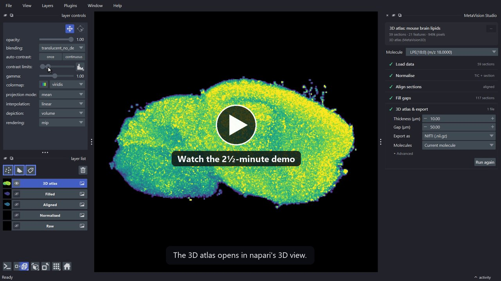
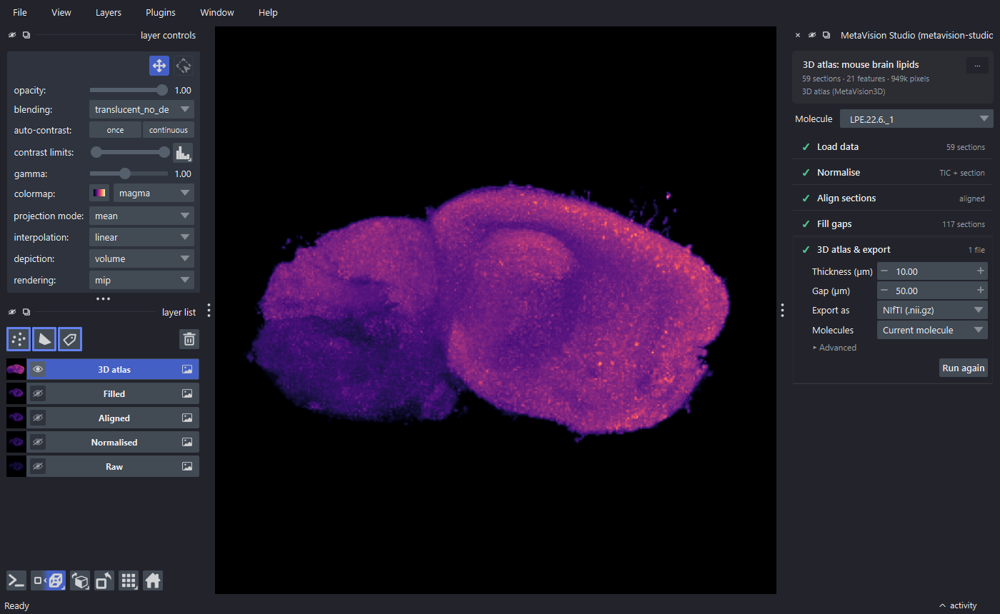
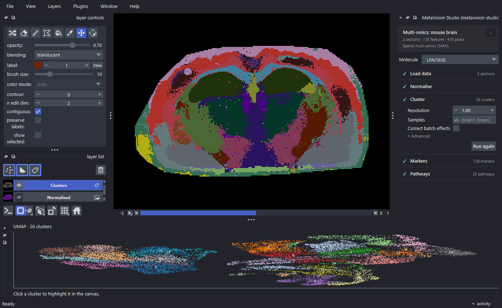

# MetaVision Studio

**3D spatial metabolomics and multi-omics MALDI imaging, point-and-click, in [napari](https://napari.org).**

MetaVision Studio packages two published methods for mass spectrometry imaging (MSI) into
one workbench, so a lab can go from exported pixel tables to 3D metabolite atlases, spatial
clusters, marker molecules and enriched pathways without writing code:

- **Build a 3D atlas** with *MetaVision3D*: normalise serial tissue sections, align them,
  fill missing pixels and sections, and export a 3D volume (NIfTI / TIFF / CSV).
- **Spatial multi-omics** with *SAMI*: combine lipidomics, metabolomics and glycomics from
  the same section, cluster pixels into anatomical regions, find marker molecules, and run
  pathway enrichment.

### Demo

[](docs/media/metavision-studio-demo.mp4)

<sub>2½ minutes, no sound: the 3D atlas example (load, normalise, align, fill, export, 3D
view, methods text), then the multi-omics example (clusters with a linked UMAP, markers,
pathways). Long steps are sped up. [Download the MP4](docs/media/metavision-studio-demo.mp4).</sub>





<sub>Screenshots use the public example data from Ma X. et al. (Zenodo, CC BY 4.0).</sub>

> **Status: pre-alpha.** Both pipelines run end to end on the published example data. The
> interface and file formats may still change before 1.0. See [docs/roadmap.md](docs/roadmap.md).

## Built on the work of Xin Ma

The scientific methods were developed by **Xin Ma** and colleagues. MetaVision Studio ports,
tests and extends their reference implementations:

- **MetaVision3D**: <https://github.com/XinBiostats/MetaVision3D>
- **SAMI**: <https://github.com/XinBiostats/SAMI>

**If you use MetaVision Studio, please cite the original methods** (see [Citing](#citing)).

## What you get

- **One panel, four steps per analysis.** Each step shows at most three settings, with
  defaults from the papers; everything else is under *Advanced*.
- **Results on napari's canvas.** Scroll through sections, switch to 3D, adjust contrast. One
  molecule picker drives every view.
- **Linked charts.** Click a section in the alignment-quality plot, a cluster in the UMAP, or
  a marker in the volcano plot, and the canvas follows.
- **Nothing freezes.** Long steps run in the background with progress and a Cancel button.
- **Reproducible projects.** Every run's settings, outputs and software versions are recorded
  in `project.json`. If you change an earlier step, later steps show as *out of date*.
- **Copy methods text.** A ready-to-paste methods paragraph with parameters, versions and
  citations.
- **Example data in one click.** Public mouse-brain datasets download on demand from Zenodo.
- **Fixes to the reference code.** Correct Benjamini–Hochberg adjustment, alignment computed
  from normalised data, natural section ordering, NIfTI files with the real voxel size, no
  float16 overflow, working lipid pathway enrichment, and more (see
  [CHANGELOG.md](CHANGELOG.md)).

## Install

MetaVision Studio needs **Python 3.12+** (developed on 3.14). Pathway enrichment also needs
**R 4.3+** ([CRAN](https://cran.r-project.org/); Windows: `winget install RProject.R`).

> A PyPI release is coming. Until then, install from source:

```bash
git clone https://github.com/hari7696/metavision3d_app.git
cd metavision3d_app
pip install -e ".[napari]"
metavision-studio install-r-deps    # three small R packages, for pathway enrichment
metavision-studio doctor            # checks Python packages, extras and R
```

Optional extras: `imzml` (read imzML directly), `harmony` (batch correction across samples;
pulls in PyTorch), `all`.

## Use it

```bash
metavision-studio gui               # or: napari, then Plugins → MetaVision Studio
```

Choose **Try the example dataset**, or **New project** to load your own CSV/Parquet exports
(columns `x`, `y`, a section column such as `tissue_id` or `region`, and one column per
molecule; the columns are detected for you to confirm).

From Python, the same steps are plain functions:

```python
from metavision_studio import io, mv3d, sami

# 3D atlas
data, _ = io.read_table("sections.csv")
norm = mv3d.normalize(data)  # TIC + section median
raster = io.build_raster(norm)
alignment = mv3d.compute_alignment(norm, raster)  # ECC on the most prevalent molecule
stack = mv3d.apply_alignment(raster.stack_feature(norm, "PI(38:4)"), alignment)
stack = mv3d.interpolate(mv3d.impute(stack), n_insert=1)
mv3d.to_nifti(stack, pixel_size_um=50, thickness_um=10, gap_um=50, n_insert=1).to_filename(
    "pi.nii.gz"
)

# Spatial multi-omics
omics = [io.read_table(f)[0] for f in ("brain_lipidomics.csv", "brain_metabolomics.csv")]
adata = sami.cluster(sami.normalize(io.merge_omics(omics)), resolution=1.0)
markers = sami.find_markers(adata, ["3"])  # cluster 3 vs the rest
pathways = sami.enrich_pathways(markers)  # R; libraries prepared on first use
```

Other commands: `metavision-studio datasets`, `metavision-studio fetch mv3d-wt2`,
`metavision-studio prepare-libraries`.

## Development

```bash
pip install hatch
hatch env create      # .venv on Python 3.14 with dev tools
hatch run test        # pytest
hatch run lint        # ruff
hatch run gui         # launch the app
```

See [CONTRIBUTING.md](CONTRIBUTING.md) and [docs/architecture.md](docs/architecture.md).

## Citing

Please cite the methods this tool implements:

- **MetaVision3D**: Ma X, *et al.* "MetaVision3D: Automated Framework for the Generation of
  Spatial Metabolome Atlas in 3D." *bioRxiv* (2023).
  [doi:10.1101/2023.11.27.568931](https://doi.org/10.1101/2023.11.27.568931).
  Software: [doi:10.5281/zenodo.14213133](https://doi.org/10.5281/zenodo.14213133)
- **SAMI**: Ma X. *XinBiostats/SAMI* (v1.0.0). Zenodo (2025).
  [doi:10.5281/zenodo.15022514](https://doi.org/10.5281/zenodo.15022514)
- **Example data**: Ma X., Zenodo, [doi:10.5281/zenodo.14212427](https://doi.org/10.5281/zenodo.14212427)
  and [doi:10.5281/zenodo.15224641](https://doi.org/10.5281/zenodo.15224641) (CC BY 4.0)

To cite MetaVision Studio itself, use GitHub's "Cite this repository" button
([CITATION.cff](CITATION.cff)). The app's **Copy methods text** includes all of the above.

## License

[CC BY-NC-SA 4.0](LICENSE), the same licence as the upstream MetaVision3D and SAMI
repositories (© 2023 University of Florida Research Foundation, Inc.). You may use, share and
adapt this software for **non-commercial** purposes with attribution; adaptations must be
shared under the same terms. Third-party notices and a summary of our changes to the
original code are in [NOTICE.md](NOTICE.md).

## Acknowledgements

- **Xin Ma**: author of the MetaVision3D and SAMI methods and reference implementations.
- **Hari Krishna Reddy Golamari**: author and maintainer of MetaVision Studio; co-author of
  MetaVision3D.
- **Dhruv** and **Priya Karnasula**: contributors to the original 2024 desktop app.
- Pathway enrichment adapts functions from [MetaboAnalystR](https://github.com/xia-lab/MetaboAnalystR)
  (MIT) and uses compound and pathway libraries derived from HMDB and SMPDB.
